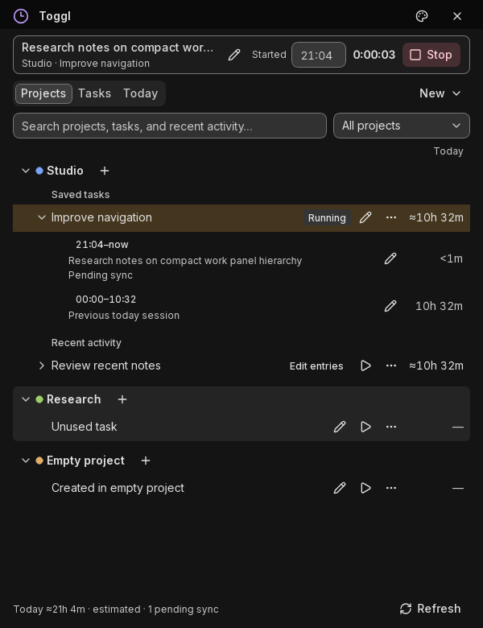

# Toggl Tray for Linux ⏱️ Press Ctrl+Shift+T, and your time is tracked

A small tray timer for [Toggl Track](https://toggl.com/track/) and
self-hosted [OpenTickly](https://github.com/CorrectRoadH/OpenTickly).
Toggl's own desktop app no longer runs on Linux. This one does, and it
keeps tracking when you are offline.




*The work window, captured from the app's own UI test with sample data.*

## What you get

- **One key to start and stop.** `Ctrl+Shift+T` works from any app.

- **The tray icon shows your state.** It takes the running project's color and turns grey when stopped.

- **No lost time when offline.** Starts and stops are saved locally and synced when the server is back.

- **Fix entries without opening a browser.** Change the task, project or start time of any of today's entries.

- **A terminal command for everything.** `toggl status`, `toggl start`, `toggl audit` and more.

- **Stays inside the free plan.** Toggl allows 30 API requests an hour, and the app budgets for that.

## Install

You need Linux on **X11** (Wayland is not supported), Python 3.11 or newer,
and a Toggl or OpenTickly account.

On Debian, Ubuntu or Linux Mint:

```bash
sudo apt install libgirepository-2.0-dev gir1.2-ayatanaappindicator3-0.1 \
  gir1.2-xapp-1.0 libsecret-tools gir1.2-webkit2-4.1
```

On Fedora:

```bash
sudo dnf install gobject-introspection-devel libappindicator-gtk3 libsecret
```

Then install the app:

```bash
git clone https://github.com/testy-cool/toggl-linux.git
cd toggl-linux
python3 -m venv .venv
.venv/bin/pip install -r requirements.txt
.venv/bin/python toggl_tray.py install-app --autostart
```

`install-app` adds the app to your desktop menu and puts a `toggl`
command in `~/.local/bin`. `--autostart` also starts it when you log in.
Leave it off if you want to start it yourself.

## Connect your account

**Toggl Track:** copy your API token from the bottom of your
[Toggl profile page](https://track.toggl.com/profile).

**OpenTickly:** sign up in its web page, then copy the token from your
avatar, **Profile**, **API Token**. Point the app at your server first:

```bash
toggl set-api-base https://your-opentickly-server/api/v9
```

Then start the app from your desktop menu, or run `toggl run`.
Right-click the tray icon, choose **Set API token...** and paste the token.
The token is stored in your desktop keyring, one per server.

Check that it is connected:

```bash
toggl doctor --cloud
```

## Daily use

| To do this | Do this |
|---|---|
| Start or stop the timer | `Ctrl+Shift+T` anywhere |
| See elapsed time | Hover over the tray icon |
| Pick a project or task | Left-click the tray icon |
| Fix the running timer | Tray menu, **Open timer** |
| See or edit today's entries | Tray menu, **Today's entries** |
| Check for missing time | Tray menu, **Doctor** or **Audit today** |

The same actions work from a terminal. They also work when the tray
window is hidden:

```bash
toggl status            # current timer and anything waiting to sync
toggl start "Write docs"
toggl stop
toggl set-start 09:00   # correct when the running timer started
toggl entries           # today's entries, synced and local
toggl sync              # push local entries now
toggl audit 2026-05-01 2026-05-31   # totals, blank entries and gaps
```

Run `toggl --help` for the full list.

## Vicinae extension

If you use the [Vicinae](https://github.com/vicinaehq/vicinae) launcher,
the [`vicinae/`](vicinae/) extension starts, stops and edits the timer
from there. It talks to the running tray app, so it needs no token of its
own. Install steps are in [`vicinae/README.md`](vicinae/README.md).

## Limits

- **X11 only.** The global hotkey uses an X11 key grab, which Wayland does not allow.

- **GNOME needs a tray extension.** Install [AppIndicator support](https://extensions.gnome.org/extension/615/appindicator-support/) to see the icon.

- **The free plan is slow to refresh.** While idle, the app checks the server at most once an hour.

- **Your data stays local.** Timer state, the offline queue and logs live in `~/.local/share/toggl-tray/`.

## Learn more

- [Windows, projects and tasks](docs/windows.md): what every window and menu does.

- [Inside the tray app](docs/how-it-works.md): data files, sync, request budget and the debug log.

- [Troubleshooting](docs/troubleshooting.md): no icon, hotkey not working, missing time.

- [Timer scenarios](docs/timer-scenarios.md): how start, stop and edits behave in each case.

## License

MIT
